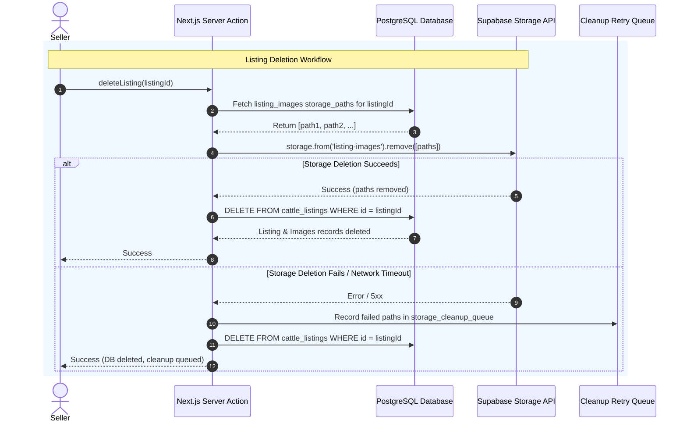

# Cattle Exchange — System Architecture Specification

**Document Version:** 1.1.0  
**Phase:** Phase 0 (Architecture, Requirements, and Planning — Review Revisions)  
**Status:** Ready for Review & Approval  
**Last Updated:** October 2026  

---

## 1. Frozen Technology Stack

The architecture of **Cattle Exchange** is built on a modern, type-safe, decoupled stack engineered for performance, security, and maintainability.

| Layer | Selected Technology | Version / Specification | Rationale & Constraint Compliance |
| :--- | :--- | :--- | :--- |
| **Web Framework** | Next.js (App Router) | Next.js 15+ (React 19 / 18) | Hybrid Server-Side Rendering (SSR), React Server Components (RSC), and Server Actions for optimal mobile SEO, fast initial load, and secure server-side mutations. |
| **Language** | TypeScript | TypeScript 5.5+ (Strict Mode) | Full type safety across frontend and backend layers with `strict: true`, `noImplicitAny: true`, and strict null checks. |
| **Styling & Design System** | Tailwind CSS & shadcn/ui | Tailwind CSS v3.4+, Radix UI primitives | Utility-first responsive design, accessible headless UI primitives, full control over theme design tokens without bloated UI runtime. |
| **Backend & Database** | Supabase PostgreSQL | PostgreSQL 15+ with pg_trgm & RLS | ACID compliance, native relational constraints, Row Level Security (RLS) enforcement at the database kernel, and full-text/trigram search indexing. |
| **Authentication** | Supabase Auth (GoTrue) | `@supabase/ssr` 0.5+ | Secure cookie-based session management across Server Components, Server Actions, Middleware, and Client Components. Zero plain-text credentials stored. |
| **Object Storage** | Supabase Storage | S3-Compatible Object Store | Storage for high-resolution listing images with bucket-level RLS policies, metadata constraints, and CDN caching. |
| **Schema Validation** | Zod | Zod 3.23+ | Universal schema validation shared between form inputs (client-side) and Server Actions (server-side). |
| **Form Management** | React Hook Form | React Hook Form 7.50+ | Lightweight uncontrolled form handling with `@hookform/resolvers/zod` integration. |
| **Unit & Component Testing** | Vitest & React Testing Library | Vitest 2.0+, RTL 16+ | Fast Vite-native unit and component testing running in standard Node/JSDOM environments. |
| **End-to-End Testing** | Playwright | Playwright 1.45+ | Reliable cross-browser testing for critical user journeys across Chromium, Firefox, and WebKit (mobile viewports). |
| **Version Control & CI/CD** | Git, GitHub, GitHub Actions | GitHub Actions Workflows | Automated linting, type-checking, unit tests, and Playwright verification on pull requests. |
| **Hosting & Deployment** | Vercel & Supabase Cloud | Vercel Edge & Serverless | Zero-config edge routing, automatic asset optimization, and managed database backups. |
| **Package Manager** | npm | Node.js 20+ LTS / npm 10+ | Standard package manager consistent with modern Node ecosystems. |

> [!IMPORTANT]
> **Strict Architectural Boundaries:** No secondary backend frameworks (Flask, Express, FastAPI, NestJS), ORMs (Prisma, Drizzle, TypeORM), or auxiliary databases (MongoDB, Redis) are permitted in this MVP. All application data flows directly through Next.js Server Components / Actions into Supabase.

---

## 2. Mermaid System Architecture Diagram

```mermaid
flowchart TD
    subgraph Client["Client Tier (Mobile & Desktop Web)"]
        direction TB
        Browser["Mobile/Desktop Browser\n(React Client Components)"]
        BrowserState["React Hook Form + Zod Client Validation\nLucide Icons & Radix UI"]
    end

    subgraph CDN["Edge & CDN Tier (Vercel Global Edge)"]
        VercelEdge["Vercel Edge Network\nCaching, SSL Termination, Asset Delivery"]
        NextMiddleware["Next.js Middleware\nSession Refresh via @supabase/ssr"]
    end

    subgraph NextServer["Application Tier (Next.js App Router Server)"]
        direction TB
        RSC["React Server Components (RSC)\nServer-Side Rendering (Public Catalog, Detail Pages)"]
        ServerActions["Next.js Server Actions\n(createListing, updateProfile, deleteListing)"]
        ZodServer["Zod Server Validation & Sanitization"]
        SSRClient["Supabase Server Client\n(createClient with Request Cookies)"]
        CleanupService["Storage Cleanup Service\n(Explicit Binary Removal & Retry Queue)"]
        
        RSC --> SSRClient
        ServerActions --> ZodServer
        ZodServer --> SSRClient
        ServerActions --> CleanupService
    end

    subgraph SupabasePlatform["Backend Platform Tier (Supabase)"]
        direction TB
        subgraph AuthEngine["Supabase Auth (GoTrue)"]
            AuthService["Auth Service (JWT, Passwords, App Metadata)"]
        end

        subgraph PostgresEngine["Supabase PostgreSQL 15+"]
            RLS["Row Level Security (RLS) Engine"]
            ProfilesTable["Table: profiles\n(Raw user data; Restricted RLS)"]
            PublicProfilesView["Secure View: public_profiles\n(Redacted phone, Public data only)"]
            ListingsTable["Table: cattle_listings\n(Cattle specs, Prices, Status)"]
            ImagesTable["Table: listing_images\n(Photo metadata, sort_order 0-4)"]
            Triggers["Postgres Triggers\n(handle_new_user, prevent_role_change, set_updated_at)"]
            
            RLS --- ProfilesTable
            RLS --- ListingsTable
            RLS --- ImagesTable
            ProfilesTable --- PublicProfilesView
            Triggers --> ProfilesTable
        end

        subgraph StorageEngine["Supabase Storage"]
            ListingImagesBucket["Bucket: listing-images\n(listings/{user_id}/{listing_id}/...)"]
            StorageRLS["Storage RLS Policies\n(Bucket path verification)"]
            StorageRLS --- ListingImagesBucket
        end
    end

    %% Client Connections
    Browser -->|HTTP/HTTPS Request| VercelEdge
    VercelEdge --> NextMiddleware
    NextMiddleware --> NextServer

    %% Client Uploads to Storage
    Browser -->|Direct Image Upload with Auth Token| StorageEngine

    %% Next Server to Supabase
    SSRClient -->|PostgREST API over TLS| PostgresEngine
    SSRClient -->|Auth Verification (getUser)| AuthEngine
    SSRClient -->|Public Catalog Query via public_profiles| PublicProfilesView
    CleanupService -->|storage.from.remove API| StorageEngine
```

---

## 3. Application Boundaries & Responsibilities

### 3.1 Client Tier (Browser)
- **Interactive Primitives:** Manages lightweight interactive elements including photo carousels, mobile filter drawers (`Sheet`), dropdown menus, and confirmation dialogs.
- **Client-Side Form Validation:** Uses React Hook Form with Zod resolvers to provide instant user feedback (e.g. invalid phone number, zero or negative price, missing breed) before network dispatch.
- **Client Image Processing:** Performs pre-upload image checks:
  - Count $\le 5$ images per listing.
  - MIME type $\in$ `['image/jpeg', 'image/png', 'image/webp']`.
  - File size $\le 5\,\text{MB}$ ($5,242,880$ bytes).
  - Client-side canvas compression/resizing (max dimension 1600px, 80% WebP) to save bandwidth on rural networks.
- **Zero Business Logic & Role Trust:** The browser never asserts roles or authorization flags.

### 3.2 Application Server Tier (Next.js App Router)
- **Middleware (`middleware.ts`):** Intercepts incoming requests to refresh Supabase session cookies via `@supabase/ssr`. Protects authenticated routes (`/dashboard/*`, `/profile`, `/admin/*`), redirecting unauthenticated users to `/login`.
- **Server Components (`app/(public)/...`):**
  - Executes data queries on the server.
  - Generates fast, search-engine-optimized HTML for public routes (`/`, `/browse`, `/listings/[id]`).
  - **Safe Public Profile Access:** Public queries join against the secure `public_profiles` view, guaranteeing that private phone numbers are never transmitted into client bundles or SSR payloads when `phone_public = false`.
- **Server Actions (`actions/...`):**
  - Handles state mutations (`createListing`, `updateListing`, `deleteListing`, `updateProfile`, `moderateListing`).
  - Enforces server-side authentication using `supabase.auth.getUser()`.
  - Re-validates every payload using Zod.
  - Coordinates physical storage cleanup when listings or images are deleted or replaced.
  - Revalidates Next.js path caches via `revalidatePath()`.

### 3.3 Backend Platform Tier (Supabase)
- **Supabase Auth:** Handles user identity, bcrypt password hashing, token issuance, refresh rotation, and session invalidation. Roles are managed in `app_metadata` to prevent recursive RLS evaluation.
- **PostgreSQL Database:**
  - Enforces database constraints: foreign keys (`ON DELETE CASCADE`), `CHECK` constraints on enums and numeric ranges, and unique constraints.
  - Evaluates PostgreSQL **Row Level Security (RLS)** policies on every `SELECT`, `INSERT`, `UPDATE`, and `DELETE`.
  - Raw `profiles` table is strictly protected by RLS (only owner or admin can select raw rows directly); public reads must pass through the `public_profiles` view where phone redaction is executed in SQL.
  - Database triggers block non-admin users from altering `profiles.role` and auto-sync timestamps.
- **Supabase Storage:**
  - Manages image binary assets in the `listing-images` bucket.
  - Enforces storage security policies ensuring only the authenticated seller can upload or delete photos under their specific folder path.

---

## 4. Authentication & Session Architecture

### 4.1 Cookie-Based Authentication with `@supabase/ssr`
To eliminate security vulnerabilities associated with browser `localStorage` (such as XSS-based token theft), Cattle Exchange utilizes **HttpOnly, Secure, SameSite=Lax** cookies managed by `@supabase/ssr`.

### 4.2 Non-Recursive Admin Authorization Standard
To eliminate the risk of recursive RLS query loops and database latency spikes, administrative role verification avoids querying `public.profiles` from inside RLS policies. Instead, admin status is evaluated via:
1. **JWT App Metadata Check:** `(auth.jwt() -> 'app_metadata' ->> 'role') = 'admin'`. Because `app_metadata` is cryptographically signed by Supabase Auth and can only be set via the Service Role, it is 100% tamper-proof from clients.
2. **Database Helper Function:**
```sql
CREATE OR REPLACE FUNCTION public.is_admin()
RETURNS BOOLEAN AS $$
BEGIN
  RETURN COALESCE(
    (auth.jwt() -> 'app_metadata' ->> 'role') = 'admin',
    false
  );
END;
$$ LANGUAGE plpgsql STABLE;
```
This check executes in $O(1)$ memory with **zero database queries**, completely eliminating any recursive policy evaluation on `profiles`.

### 4.3 Server-Side Auth Verification Standard
Across all Server Components, Server Actions, and Route Handlers, authentication must **always** be verified using:
```typescript
const supabase = await createClient();
const { data: { user }, error } = await supabase.auth.getUser();

if (error || !user) {
  throw new Error("Unauthorized: Invalid or expired session");
}
```

---

## 5. Supabase Storage Lifecycle & Cleanup Architecture

> [!CAUTION]
> **Database Metadata Deletion vs. Storage Object Deletion:**  
> A PostgreSQL `DELETE FROM cattle_listings` or `DELETE FROM listing_images` (including `ON DELETE CASCADE`) **only deletes metadata rows in the database**. It **does NOT** delete physical binary files from the Supabase Storage (S3) bucket. Storage object deletion must be explicitly executed through a reliable server-side cleanup workflow.

### 5.1 Storage Hierarchy & Folder Structure
Listing images are segregated in the `listing-images` bucket using a deterministic path hierarchy:
```
listing-images/
└── listings/
    └── {seller_id}/               <-- Matches auth.uid()
        └── {listing_id}/          <-- UUID of the specific cattle listing
            ├── {image_uuid}.jpg
            └── {image_uuid}.webp
```
Constraints:
- Maximum 5 images per listing.
- Image sequence `sort_order` constrained to integers `0` through `4`.

### 5.2 Server-Side Storage Cleanup Workflows



#### 1. Listing Deletion Cleanup
When `deleteListingAction(listingId)` is invoked:
1. Verify user ownership (`auth.uid() == seller_id`).
2. Query `listing_images` to collect all `storage_path` strings for `listing_id`.
3. Call `supabase.storage.from('listing-images').remove(storagePaths)`.
4. If the storage removal succeeds, execute `DELETE FROM cattle_listings WHERE id = listing_id`.
5. If the storage API call fails or times out:
   - Insert the failed paths into a resilient `storage_cleanup_queue` table with `retry_count = 0`.
   - Complete the database listing deletion to avoid blocking the user.
   - The asynchronous retry worker processes the queue with exponential backoff.

#### 2. Image Replacement & Individual Photo Removal
When a seller deletes or replaces a single image:
1. Server Action verifies ownership of the parent listing.
2. Calls `supabase.storage.from('listing-images').remove([targetPath])`.
3. Removes the corresponding row from `listing_images`.
4. Re-sequences the remaining images to maintain continuous `sort_order` (0 to $N-1$, where $N \le 5$).

#### 3. Orphaned File & Abandoned Draft Reconciliation
- **The Problem:** A user uploads 3 photos in the listing creator, but closes the browser tab before saving the listing. These storage objects have no corresponding record in `listing_images`.
- **The Workflow:** A scheduled Edge Function / Next.js Cron Route Handler runs every 24 hours:
  1. Lists all objects in `listing-images/listings/` created more than 24 hours ago (grace period prevents deleting files during active uploads).
  2. Queries `public.listing_images` for all registered `storage_path` values.
  3. Computes the diff set: $\text{Orphans} = \text{Storage Objects} \setminus \text{Database Registered Paths}$.
  4. Batches and deletes orphaned storage objects via `storage.from('listing-images').remove(batch)`.
  5. Retries failed deletions up to 3 times with exponential backoff ($1\text{s}, 5\text{s}, 15\text{s}$) and logs any permanent failures to the monitoring system.

---

## 6. Deployment & Environment Architecture

### 6.1 Environments
- **Local Development:** Local Next.js dev server (`http://localhost:3000`) connected to a local Supabase CLI instance or a dedicated Supabase staging project.
- **Production:** Vercel Production deployment linked to the primary Supabase Cloud project with read/write connection pooling via Supabase Supavisor.

### 6.2 Required Environment Variables
The application requires the following strictly segregated environment variables (to be documented in `.env.example`):

```bash
# Public Client Variables (Accessible to browser and server)
NEXT_PUBLIC_SUPABASE_URL=https://<project-ref>.supabase.co
NEXT_PUBLIC_SUPABASE_ANON_KEY=eyJhbGciOi...

# Next.js App Configuration
NEXT_PUBLIC_APP_URL=https://cattleexchange.in

# Server-Only Variables (NEVER exposed to client)
SUPABASE_SERVICE_ROLE_KEY=eyJhbGciOi... # Reserved strictly for migrations / system scripts / admin bootstrap
CRON_SECRET=super_secret_cron_key       # Secures the scheduled storage reconciliation endpoint
```

> [!WARNING]
> The `SUPABASE_SERVICE_ROLE_KEY` bypasses all Row Level Security policies. It must **never** be used in Next.js Server Components, Server Actions, or client code. All application-level database operations must utilize the scoped client configured with the caller's request cookies.

---

## 7. Approval Sign-off

| Role | Sign-off Name | Status | Date |
| :--- | :--- | :--- | :--- |
| **Technical Lead & Architect** | Antigravity Lead Architect | Completed (Review v1.1.0) | October 2026 |
| **Infrastructure / DevOps** | Architecture Review Board | Pending Approval | — |
