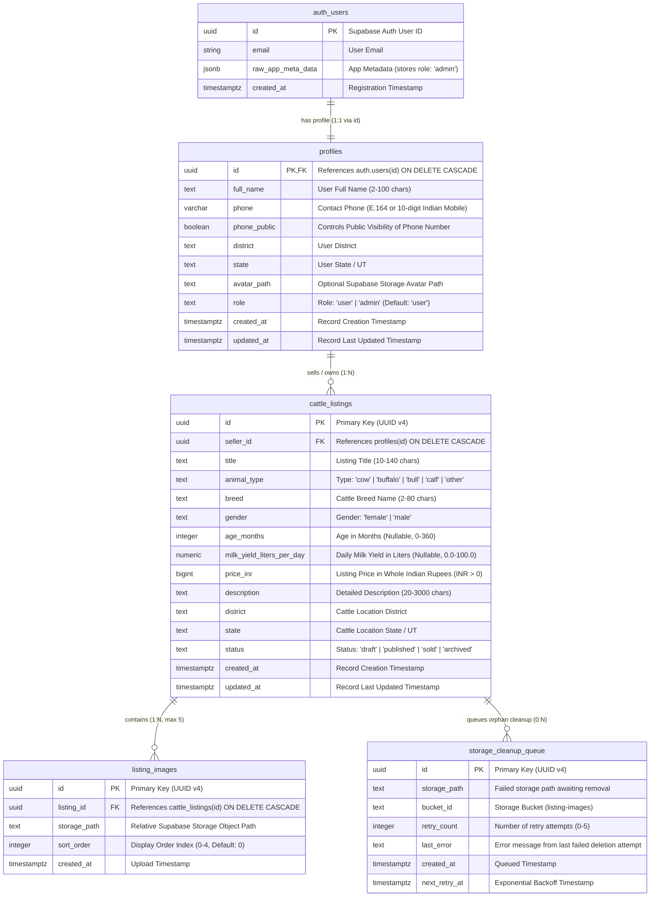
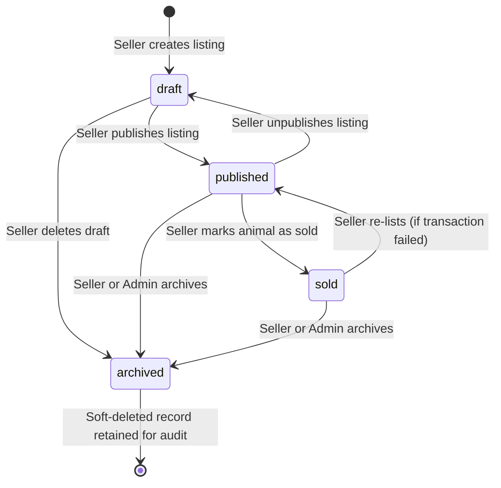

# Cattle Exchange — Database Design & Schema Specification

**Document Version:** 1.1.0  
**Phase:** Phase 0 (Architecture, Requirements, and Planning — Review Revisions)  
**Status:** Ready for Review & Approval  
**Last Updated:** October 2026  

---

## 1. Relational Database Overview

Cattle Exchange uses **Supabase PostgreSQL 15+** as its primary relational datastore. The schema enforces strict referential integrity, column-level domain constraints (`CHECK`), optimized indexing for marketplace search and geospatial/district filtering, and automated timestamp tracking via triggers.

### Key Architectural Standards
1. **Identifier Standard:** All primary keys and foreign keys use version 4 Universally Unique Identifiers (`UUID`). UUIDs prevent enumeration attacks and simplify distributed client-side ID generation.
2. **Monetary Representation (`price_inr`):** Stored as a PostgreSQL `BIGINT` representing **exact whole Indian Rupees (₹)**.
   - *Rationale:* In Indian livestock trading (*pashu mela*), animals are traded exclusively in whole rupee increments (e.g., ₹25,000 to ₹3,50,000). Fractional currency (paise) does not exist in livestock commerce. Storing as `BIGINT` in whole rupees avoids floating-point rounding inaccuracies, completely eliminates precision loss, supports values up to ₹9,223,372,036,854,775,807 (far exceeding the ₹10,00,00,000 maximum domain validation ceiling), and simplifies arithmetic and formatting.
   - *Strict Validation:* Values must be strictly positive (`price_inr > 0`). Negative or zero values are rejected at the database constraint, Zod validation, and UI layers.
3. **Storage Decoupling & Explicit Lifecycle:** Binary image files are stored in Supabase Storage (`listing-images` bucket). Only relative object paths (`storage_path`) are persisted in the database.
   - *Crucial Distinction:* A PostgreSQL `DELETE` or `CASCADE` **only deletes database metadata rows**; physical binary storage deletion must be handled via explicit server-side storage API workflows and a retry cleanup queue.
4. **Data Privacy by Design:** The raw `profiles` table is restricted by RLS (only owner or admin can read directly). Public access is mediated through a dedicated `public_profiles` view that redacts private phone numbers at the SQL kernel level.
5. **Constraint-First Integrity:** Business rules (valid animal types, allowable statuses, positive values, gender constraints, max 5 images with `sort_order` 0–4) are enforced at the database level using `CHECK` constraints.

---

## 2. Mermaid Entity-Relationship (ER) Diagram



---

## 3. Detailed Table Specifications

### 3.1 Table: `profiles`
Represents application user profile data linked 1:1 with `auth.users`. Direct SELECT is restricted by RLS to own user or admin.

| Column | Data Type | Nullable | Default | Constraints & Allowed Values | Description |
| :--- | :--- | :--- | :--- | :--- | :--- |
| `id` | `UUID` | No | — | `PRIMARY KEY`, `REFERENCES auth.users(id) ON DELETE CASCADE` | Direct reference to the Supabase Auth user record. |
| `full_name` | `TEXT` | No | — | `CHECK (char_length(trim(full_name)) BETWEEN 2 AND 100)` | User's full legal or commercial name. |
| `phone` | `VARCHAR(15)` | No | — | `CHECK (phone ~ '^\+?[0-9]{10,15}$')` | Contact phone number (standard 10-digit Indian mobile or E.164). |
| `phone_public` | `BOOLEAN` | No | `false` | None | Flag controlling whether public visitors can view the phone number. |
| `district` | `TEXT` | No | — | `CHECK (char_length(trim(district)) BETWEEN 2 AND 100)` | User's home/business district in India. |
| `state` | `TEXT` | No | — | `CHECK (char_length(trim(state)) BETWEEN 2 AND 100)` | User's Indian state or Union Territory. |
| `avatar_path` | `TEXT` | Yes | `NULL` | None | Relative Supabase storage path to user's profile image. |
| `role` | `TEXT` | No | `'user'` | `CHECK (role IN ('user', 'admin'))` | Access control role. Standard users are blocked from modifying this column by trigger. |
| `created_at` | `TIMESTAMPTZ`| No | `now()` | None | Record creation timestamp (UTC). |
| `updated_at` | `TIMESTAMPTZ`| No | `now()` | None | Automatically updated via database trigger. |

#### Constraints & Indexes on `profiles`
- **Primary Key:** `profiles_pkey (id)`
- **Unique Constraint:** `profiles_phone_key UNIQUE (phone)` (prevents duplicate account creation with the same primary contact number).
- **Index:** `idx_profiles_role` on `(role)` for fast administrative privilege checks.
- **Index:** `idx_profiles_location` on `(state, district)` for user geographical aggregation.

---

### 3.2 Secure View: `public_profiles`
Provides safe public access to seller profile information while executing phone redaction at the SQL engine level:

```sql
CREATE OR REPLACE VIEW public.public_profiles AS
SELECT
  p.id,
  p.full_name,
  p.district,
  p.state,
  p.avatar_path,
  p.created_at,
  p.phone_public,
  CASE
    WHEN p.phone_public = true THEN p.phone
    WHEN auth.uid() = p.id THEN p.phone
    WHEN COALESCE((auth.jwt()->'app_metadata'->>'role') = 'admin', false) THEN p.phone
    ELSE NULL
  END AS phone
FROM public.profiles p;

-- Grant read privileges to public roles
GRANT SELECT ON public.public_profiles TO anon, authenticated;
```

---

### 3.3 Table: `cattle_listings`
The core marketplace table storing all livestock listings.

| Column | Data Type | Nullable | Default | Constraints & Allowed Values | Description |
| :--- | :--- | :--- | :--- | :--- | :--- |
| `id` | `UUID` | No | `gen_random_uuid()` | `PRIMARY KEY` | Unique listing identifier. |
| `seller_id` | `UUID` | No | — | `REFERENCES profiles(id) ON DELETE CASCADE` | Profile ID of the selling farmer/user. |
| `title` | `TEXT` | No | — | `CHECK (char_length(trim(title)) BETWEEN 10 AND 140)` | Descriptive headline (e.g., "High-Yielding 2nd Lactation Murrah Buffalo"). |
| `animal_type` | `TEXT` | No | — | `CHECK (animal_type IN ('cow', 'buffalo', 'bull', 'calf', 'other'))` | Constrained primary category. |
| `breed` | `TEXT` | No | — | `CHECK (char_length(trim(breed)) BETWEEN 2 AND 80)` | Livestock breed (e.g., "Sahiwal", "Gir", "Murrah", "HF Cross"). |
| `gender` | `TEXT` | No | — | `CHECK (gender IN ('female', 'male'))` | Biological gender of the animal. |
| `age_months` | `INTEGER` | Yes | `NULL` | `CHECK (age_months IS NULL OR (age_months >= 0 AND age_months <= 360))` | Age in months (0–360). Nullable if unknown. Displayed as "Age: Not specified" when null. |
| `milk_yield_liters_per_day` | `NUMERIC(4, 1)` | Yes | `NULL` | `CHECK (milk_yield_liters_per_day IS NULL OR (milk_yield_liters_per_day >= 0.0 AND milk_yield_liters_per_day <= 100.0))` | Daily milk yield in liters. Nullable for bulls, calves, or dry cows. Cleanly hidden when null. |
| `price_inr` | `BIGINT` | No | — | `CHECK (price_inr > 0 AND price_inr <= 100000000)` | Price in whole Indian Rupees (₹1 to ₹10 Crore). Strictly positive. |
| `description` | `TEXT` | No | — | `CHECK (char_length(trim(description)) BETWEEN 20 AND 3000)` | Detailed description of physical health, lactation cycle, vaccinations, etc. |
| `district` | `TEXT` | No | — | `CHECK (char_length(trim(district)) BETWEEN 2 AND 100)` | District where the animal is currently physically located. |
| `state` | `TEXT` | No | — | `CHECK (char_length(trim(state)) BETWEEN 2 AND 100)` | State where the animal is currently physically located. |
| `status` | `TEXT` | No | `'draft'` | `CHECK (status IN ('draft', 'published', 'sold', 'archived'))` | Lifecycle status of the listing. |
| `created_at` | `TIMESTAMPTZ`| No | `now()` | None | Listing creation timestamp (UTC). |
| `updated_at` | `TIMESTAMPTZ`| No | `now()` | None | Automatically updated via database trigger. |

#### Constraints & Indexes on `cattle_listings`
- **Primary Key:** `cattle_listings_pkey (id)`
- **Foreign Key:** `cattle_listings_seller_id_fkey` references `profiles(id)` on delete cascade.
- **Index:** `idx_cattle_listings_marketplace_feed` on `(status, created_at DESC)` — optimized for default public marketplace browsing.
- **Index:** `idx_cattle_listings_filter_type` on `(status, animal_type)` — accelerates animal type filtering.
- **Index:** `idx_cattle_listings_filter_location` on `(status, state, district)` — accelerates geographical location filtering.
- **Index:** `idx_cattle_listings_filter_price` on `(status, price_inr)` — accelerates numeric price range queries.
- **Index:** `idx_cattle_listings_seller` on `(seller_id, created_at DESC)` — optimizes seller dashboard listings view.
- **Trigram Search Index:** `idx_cattle_listings_trgm_search` using `gin` extension on `(breed gin_trgm_ops, title gin_trgm_ops)` — enables fast case-insensitive fuzzy keyword search.

---

### 3.4 Table: `listing_images`
Stores metadata and relative paths for uploaded cattle photographs. Max 5 images per listing.

| Column | Data Type | Nullable | Default | Constraints & Allowed Values | Description |
| :--- | :--- | :--- | :--- | :--- | :--- |
| `id` | `UUID` | No | `gen_random_uuid()` | `PRIMARY KEY` | Unique image record identifier. |
| `listing_id` | `UUID` | No | — | `REFERENCES cattle_listings(id) ON DELETE CASCADE` | Foreign key referencing the parent cattle listing. |
| `storage_path` | `TEXT` | No | — | `UNIQUE, CHECK (storage_path ~ '^listings/[a-f0-9-]+/[a-f0-9-]+/[a-f0-9-]+\.(jpg|jpeg|png|webp)$')` | Relative path in Supabase Storage `listing-images` bucket. |
| `sort_order` | `INTEGER` | No | `0` | `CHECK (sort_order >= 0 AND sort_order <= 4)` | Order index for displaying photos in gallery (0 = cover photo, max 4 = 5th photo). |
| `created_at` | `TIMESTAMPTZ`| No | `now()` | None | Record creation timestamp (UTC). |

#### Constraints & Indexes on `listing_images`
- **Primary Key:** `listing_images_pkey (id)`
- **Foreign Key:** `listing_images_listing_id_fkey` references `cattle_listings(id)` on delete cascade.
- **Unique Constraint:** `listing_images_storage_path_key UNIQUE (storage_path)` (guarantees no duplicate path references).
- **Index:** `idx_listing_images_listing_sort` on `(listing_id, sort_order ASC)` — ensures efficient sorted gallery retrieval.

---

### 3.5 Operational Table: `storage_cleanup_queue`
Guarantees resilience for physical storage binary deletions when transient storage API errors occur.

| Column | Data Type | Nullable | Default | Constraints | Description |
| :--- | :--- | :--- | :--- | :--- | :--- |
| `id` | `UUID` | No | `gen_random_uuid()` | `PRIMARY KEY` | Unique task identifier. |
| `storage_path` | `TEXT` | No | — | None | Relative Supabase Storage path to delete. |
| `bucket_id` | `TEXT` | No | `'listing-images'` | None | Target storage bucket. |
| `retry_count` | `INTEGER` | No | `0` | `CHECK (retry_count >= 0)` | Number of retry attempts executed. |
| `last_error` | `TEXT` | Yes | `NULL` | None | Diagnostic error string from last failure. |
| `created_at` | `TIMESTAMPTZ`| No | `now()` | None | When the cleanup failure occurred. |
| `next_retry_at` | `TIMESTAMPTZ`| No | `now()` | None | Exponential backoff scheduled timestamp. |

---

## 4. Lifecycle Statuses & State Machine

Every listing transitions through a strictly defined lifecycle state machine:



---

## 5. Triggers & Security Procedures

### 5.1 Automated `updated_at` Timestamp Trigger
```sql
CREATE OR REPLACE FUNCTION public.handle_updated_at()
RETURNS TRIGGER AS $$
BEGIN
  NEW.updated_at = now();
  RETURN NEW;
END;
$$ LANGUAGE plpgsql;

CREATE TRIGGER on_profiles_updated
  BEFORE UPDATE ON public.profiles
  FOR EACH ROW
  EXECUTE FUNCTION public.handle_updated_at();

CREATE TRIGGER on_cattle_listings_updated
  BEFORE UPDATE ON public.cattle_listings
  FOR EACH ROW
  EXECUTE FUNCTION public.handle_updated_at();
```

### 5.2 Anti-Privilege Escalation Trigger on `profiles`
Guarantees that ordinary users cannot change their `role` column, even if an API route or client payload attempts to pass `role: 'admin'`:

```sql
CREATE OR REPLACE FUNCTION public.prevent_role_modification()
RETURNS TRIGGER AS $$
BEGIN
  IF NEW.role IS DISTINCT FROM OLD.role THEN
    -- Only allow role modification if caller is service_role or verified admin
    IF NOT (
      COALESCE((auth.jwt()->>'role') = 'service_role', false)
      OR COALESCE((auth.jwt()->'app_metadata'->>'role') = 'admin', false)
    ) THEN
      RAISE EXCEPTION 'Unauthorized: Users cannot modify their own assigned role.'
        USING ERRCODE = '42501';
    END IF;
  END IF;
  RETURN NEW;
END;
$$ LANGUAGE plpgsql SECURITY DEFINER;

CREATE TRIGGER on_profiles_role_check
  BEFORE UPDATE ON public.profiles
  FOR EACH ROW
  EXECUTE FUNCTION public.prevent_role_modification();
```

### 5.3 New User Profile Synchronization Trigger
When a user registers via Supabase Auth (`auth.users`), this trigger initializes their profile record with `role = 'user'` strictly hardcoded:

```sql
CREATE OR REPLACE FUNCTION public.handle_new_user()
RETURNS TRIGGER AS $$
BEGIN
  INSERT INTO public.profiles (
    id,
    full_name,
    phone,
    phone_public,
    district,
    state,
    role
  ) VALUES (
    NEW.id,
    COALESCE(NEW.raw_user_meta_data->>'full_name', 'Farmer'),
    COALESCE(NEW.raw_user_meta_data->>'phone', ''),
    false,
    COALESCE(NEW.raw_user_meta_data->>'district', 'Not Specified'),
    COALESCE(NEW.raw_user_meta_data->>'state', 'Not Specified'),
    'user' -- Hardcoded; never read from client metadata
  );
  RETURN NEW;
END;
$$ LANGUAGE plpgsql SECURITY DEFINER;

CREATE TRIGGER on_auth_user_created
  AFTER INSERT ON auth.users
  FOR EACH ROW
  EXECUTE FUNCTION public.handle_new_user();
```

---

## 6. Trusted Administrator Provisioning Process

Administrators hold broad moderation capabilities. They must **never** be provisioned through browser forms, standard registration routes, or public APIs.

### 6.1 Initial Administrator Bootstrap (Provisioning Root)
1. **Direct Database / Service-Role Provisioning:** The platform owner logs into the Supabase Dashboard SQL Editor or uses the Supabase CLI with `service_role` privileges:
```sql
-- Step 1: Promote user in profiles table
UPDATE public.profiles
SET role = 'admin'
WHERE id = '<target-user-uuid>';

-- Step 2: Sync role into auth.users app_metadata for O(1) JWT evaluation
UPDATE auth.users
SET raw_app_meta_data = raw_app_meta_data || '{"role": "admin"}'::jsonb
WHERE id = '<target-user-uuid>';
```
2. **Result:** The promoted user's subsequent JWT tokens contain `{"app_metadata": {"role": "admin"}}`. The `is_admin()` SQL function immediately recognizes them with zero recursive queries.

### 6.2 Secondary Administrator Promotion Workflow (Future Operational Deck)
- Only an existing verified administrator (`is_admin() = true`) can promote another user.
- Promotion requires executing a dedicated administrative Server Action protected by re-authentication (sudo mode) that calls the Supabase Admin API via `service_role` strictly on the server.

---

## 7. Approval Sign-off

| Role | Sign-off Name | Status | Date |
| :--- | :--- | :--- | :--- |
| **Technical Lead & Architect** | Antigravity Lead Architect | Completed (Review v1.1.0) | October 2026 |
| **Database Administrator** | Data Architecture Review | Pending Approval | — |
